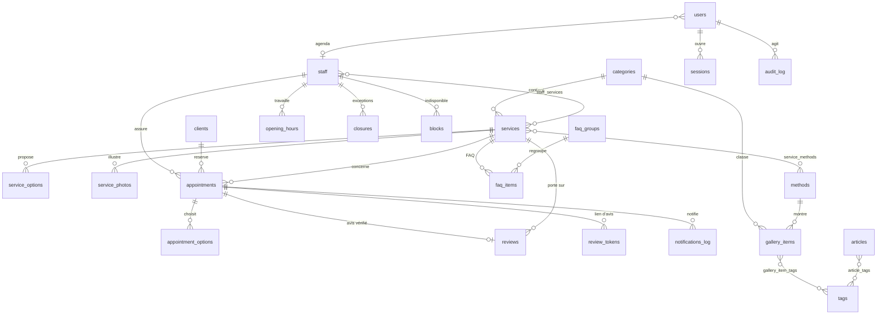

# Base de données

PostgreSQL 17 (16+ requis). SQL écrit à la main, driver `pg`, requêtes **toujours paramétrées**, migrations
numérotées dans `src/server/db/migrations/` (jamais modifiées une fois appliquées : on en ajoute une).
Le schéma couvre **toutes les phases** : les tables de réservation, d'avis, d'auth et de journaux existent
déjà (vides) pour que les phases 4 à 6 n'aient qu'à y brancher du code.

```bash
npm run db:up        # démarre PostgreSQL (Docker)
npm run db:migrate   # applique les migrations manquantes
npm run db:seed      # contenus de départ (dev uniquement, idempotent)
```

## Conventions

- **Identifiants** : `bigint identity` pour le catalogue et le contenu ; `uuid` pour tout ce qui est exposé dans une URL ou
  contient des données personnelles (clientes, rendez-vous, avis, utilisateurs).
- **Argent** : centimes (`integer`). Le code manipule des euros ; la conversion se fait dans les `repo.js`.
- **Durées** : minutes. **Dates** : `timestamptz` stocké en UTC (la session `pg` force `timezone=UTC`),
  affichage en `Europe/Paris`. Horaires d'ouverture : `time` local au salon.
- **Slugs** : contrôlés par `CHECK (slug ~ '^[a-z0-9]+(-[a-z0-9]+)*$')`.
- **`is_placeholder`** : valeurs d'exemple à faire valider (prix, durées, options, avis, visuels). Badge « à confirmer »
  **uniquement en admin** ; jamais exposé dans l'API publique.
- **`updated_at`** : tenu par le déclencheur `set_updated_at()`.
- **Jetons** (RDV, avis, sessions) : ≥ 32 octets aléatoires côté appli ; seule l'empreinte SHA-256 (`bytea`) est stockée.

## Migrations

| Fichier                       | Contenu                                                                                                                |
| ----------------------------- | ---------------------------------------------------------------------------------------------------------------------- |
| `0001_extensions_et_reglages` | `btree_gist`, `citext`, `pgcrypto` ; table `settings`                                                                  |
| `0002_catalogue`              | `categories`, `services`, `service_options`, `service_photos`, `methods`, `service_methods`, `faq_groups`, `faq_items` |
| `0003_comptes`                | `users`, `sessions`                                                                                                    |
| `0004_planning`               | `staff`, `staff_services`, `opening_hours`, `closures`, `blocks`                                                       |
| `0005_clients_rendez_vous`    | `clients`, `appointments` (contrainte `EXCLUDE`), `appointment_options`                                                |
| `0006_avis`                   | `reviews`, `review_tokens`                                                                                             |
| `0007_contenu`                | `tags`, `gallery_items`, `gallery_item_tags`, `articles`, `article_tags`, `content_blocks`                             |
| `0008_journaux`               | `notifications_log`, `audit_log` (ajout seul)                                                                          |

## Schéma



## Tables par domaine

### Catalogue (module `services`)

| Table                      | Rôle                                                                                                                                                                                                                                  |
| -------------------------- | ------------------------------------------------------------------------------------------------------------------------------------------------------------------------------------------------------------------------------------- |
| `categories`               | Installation, resserrage, détox, coloration, coiffure (titre, intro, ordre).                                                                                                                                                          |
| `services`                 | Prestation : durées min/max, tampon, prix en centimes, « à partir de », sur devis, acompte, actif, réservable en ligne, test d'allergie, `is_placeholder`. `category_id` NULL = hors catégories. `body` (jsonb) = description longue. |
| `service_options`          | Suppléments (prix + minutes en plus). Unique par (prestation, libellé).                                                                                                                                                               |
| `service_photos`           | Légendes et chemins d'image (`image_path` NULL tant que les originales ne sont pas importées).                                                                                                                                        |
| `methods`                  | Guide des méthodes de locks ; `service_id` = prestation qui la présente.                                                                                                                                                              |
| `service_methods`          | Méthodes proposées par prestation, ordonnées.                                                                                                                                                                                         |
| `faq_groups` / `faq_items` | Questions fréquentes : un item appartient soit à un groupe du site, soit à une prestation (`CHECK num_nonnulls = 1`).                                                                                                                 |

### Planning et réservation (phase 4)

| Table                 | Rôle                                                                                                                                                                              |
| --------------------- | --------------------------------------------------------------------------------------------------------------------------------------------------------------------------------- |
| `staff`               | Praticiennes réservables (une seule au départ, multi-praticiennes prêt).                                                                                                          |
| `staff_services`      | Qui réalise quoi.                                                                                                                                                                 |
| `opening_hours`       | Plages hebdomadaires (ISO : 1 = lundi). Plusieurs par jour ; chevauchement interdit (`EXCLUDE`). Horaires par défaut (mar-ven 9h-12h/14h-18h, sam 14h-18h), modifiables en admin. |
| `closures`            | Jours fermés, congés, horaires spéciaux (`staff_id` NULL = tout le salon).                                                                                                        |
| `blocks`              | Blocages manuels en instants précis.                                                                                                                                              |
| `clients`             | Clientes : email unique (`citext`), consentements SMS et newsletter (opt-in avec preuve horodatée), `anonymized_at`.                                                              |
| `appointments`        | Rendez-vous : statut, instantané durée/prix, jeton « gérer mon RDV » hashé.                                                                                                       |
| `appointment_options` | Options choisies, libellé et prix figés.                                                                                                                                          |

**Anti-double-réservation.** `appointments_no_overlap` est une contrainte `EXCLUDE USING gist`
`(staff_id WITH =, tstzrange(starts_at, ends_at, '[)') WITH &&)` limitée aux statuts qui occupent le planning
(`pending`, `confirmed`, `completed`, `no_show`). Conséquences :

- deux rendez-vous qui se touchent (fin = début suivant) sont acceptés ;
- un rendez-vous annulé libère immédiatement le créneau ;
- la contrainte tient sous concurrence ; le service de réservation travaille en plus dans une transaction et
  traduit l'erreur `23P01` en « créneau déjà pris » ;
- `ends_at` inclut le tampon (durée max + options + tampon, §7.3) ;
- les blocages (`blocks`) et fermetures ne peuvent pas être couverts par une contrainte entre tables : le moteur
  de disponibilités les soustrait des créneaux proposés.

Statuts (§7.4) : `pending` (en attente), `confirmed`, `completed`, `cancelled_by_client`, `cancelled_by_salon`, `no_show`.

### Avis (module `reviews`)

| Table           | Rôle                                                                                                                                                                                                       |
| --------------- | ---------------------------------------------------------------------------------------------------------------------------------------------------------------------------------------------------------- |
| `reviews`       | Note 1–5, texte, consentement, statut de modération (`pending`/`approved`/`rejected`), mise en avant, réponse publique. Un seul avis par rendez-vous (`UNIQUE`). Lecture publique : `status = 'approved'`. |
| `review_tokens` | Lien de dépôt : empreinte du jeton, expiration 30 jours, usage unique, relance J+5.                                                                                                                        |

Garde-fous : un avis approuvé exige le consentement ; un avis « vérifié » exige un rendez-vous (sauf exemples).
Les 8 avis actuels sont des **exemples** (`is_placeholder = true`) à remplacer avant la mise en ligne.

### Contenu (modules `gallery` et `content`)

| Table                       | Rôle                                                                                                          |
| --------------------------- | ------------------------------------------------------------------------------------------------------------- |
| `tags`                      | Étiquettes typées : `size` (taille des locks, filtre de la galerie), `topic` (thème d'article).               |
| `gallery_items`             | Réalisations : catégorie, méthode, ratio, `image_path` (NULL = placeholder), `featured`.                      |
| `gallery_item_tags`         | Étiquettes d'une réalisation.                                                                                 |
| `articles` / `article_tags` | Journal « Conseils » : sections en jsonb, `draft` ou `published` (+ date).                                    |
| `content_blocks`            | Blocs de texte éditables par clé (`methods.stages` : étapes de maturation des locks).                         |
| `settings`                  | Réglages clé/valeur (jsonb) : `booking.*`, `salon.*`, et `site.*` (annonce, fondatrice, chiffres, Instagram). |

### Comptes et journaux (phases 5 et 6)

| Table               | Rôle                                                                                                                        |
| ------------------- | --------------------------------------------------------------------------------------------------------------------------- |
| `users`             | Comptes admin : hash argon2id, rôle `owner`/`staff`, secret TOTP chiffré, codes de secours hashés, verrouillage progressif. |
| `sessions`          | Sessions serveur : empreinte du jeton, `mfa_verified`, expiration.                                                          |
| `notifications_log` | Chaque email/SMS : modèle, destinataire, statut, erreur, tentatives.                                                        |
| `audit_log`         | Actions admin, **ajout seul** (déclencheur qui interdit `UPDATE`).                                                          |

## Données personnelles et conservation (RGPD, §14)

| Donnée                                        | Où                             | Conservation proposée                                            |
| --------------------------------------------- | ------------------------------ | ---------------------------------------------------------------- |
| Identité, email, téléphone, historique de RDV | `clients`, `appointments`      | 3 ans après le dernier RDV, puis anonymisation (`anonymized_at`) |
| Photo des cheveux                             | `appointments.hair_photo_path` | Supprimée 1 an après le RDV                                      |
| Destinataires des envois                      | `notifications_log.recipient`  | Purge après 12 mois                                              |
| Sessions expirées                             | `sessions`                     | Purge quotidienne (`expires_at < now()`)                         |
| Adresse IP                                    | `sessions`, `audit_log`        | Purge après 12 mois                                              |

Ces durées sont **appliquées chaque jour** par `modules/retention` (lancée par `index.js`). La durée des clientes est le réglage `privacy.client_retention_years` (1 à 10, 3 par défaut ; pas d'écran d'admin, à modifier en base). La politique de confidentialité reprend ces durées. Les adresses IP du journal d'audit sont mises à NULL (migration 0011), jamais les lignes.

## Seeds

Les contenus de la phase 2 (`src/server/db/seeds/*.json`) sont chargés par `db/seed-content.js` (SQL paramétré,
`ON CONFLICT … DO UPDATE` : relançable sans doublon). Tout ce qui est chiffré est marqué `is_placeholder = true`.
Le seed crée aussi une praticienne par défaut (« La fondatrice ») rattachée aux prestations réservables.
Horaires par défaut : **mardi-vendredi 9h-12h puis 14h-18h, samedi 14h-18h, fermé lundi et dimanche**, semés
seulement si la praticienne n'en a aucun, donc modifiables sans être écrasés.
`db:seed` est refusé en production.

## Tests

`npm test` crée et prépare une base **`<base>_test`** (migrations + seeds) : la base de dev n'est jamais touchée.
`db/schema.test.js` prouve les contraintes (chevauchement, plages d'ouverture, audit, avis, idempotence du seed).
