# Guide de la propriétaire : utiliser l'espace pro

> Cet espace s'appelle **l'espace pro** (ou « admin »). Il sert à gérer vos rendez-vous, vos clientes, vos prix, vos photos et vos avis, **sans toucher au code**.
> Il fonctionne sur **téléphone** (pensé pour ça) et sur ordinateur.
> Les captures ci-dessous utilisent des **données de démonstration** (noms et rendez-vous fictifs).

**Adresse** : `https://VOTRE-DOMAINE/admin` (ajoutez-la aux favoris, ou utilisez « Ajouter à l'écran d'accueil » dans le menu de votre navigateur : vous aurez une icône comme pour une application).

---

## Sommaire

1. [Se connecter (mot de passe + code)](#1-se-connecter)
2. [Aujourd'hui : le tableau de bord](#2-aujourdhui--le-tableau-de-bord)
3. [Agenda et rendez-vous](#3-agenda-et-rendez-vous)
4. [Clientes](#4-clientes)
5. [Prestations et tarifs](#5-prestations-et-tarifs)
6. [Galerie de photos](#6-galerie-de-photos)
7. [Avis](#7-avis)
8. [Contenus du site](#8-contenus-du-site)
9. [Réglages](#9-réglages)
10. [Messages envoyés et journal d'activité](#10-messages-envoyés-et-journal-dactivité)
11. [Mon compte](#11-mon-compte)
12. [Ce que vos clientes reçoivent automatiquement](#12-ce-que-vos-clientes-reçoivent-automatiquement)
13. [Questions fréquentes](#13-questions-fréquentes)
14. [Ce qui ne se modifie pas encore ici](#14-ce-qui-ne-se-modifie-pas-encore-ici)

---

## 1. Se connecter

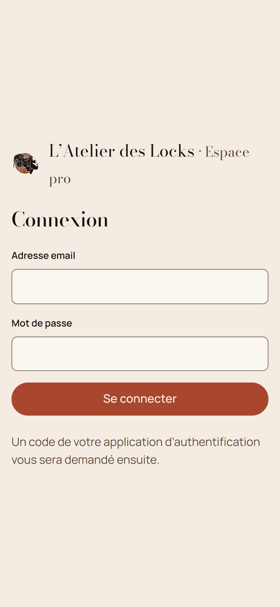

La connexion se fait en **deux temps**, pour protéger les données de vos clientes :

1. votre **adresse email** et votre **mot de passe** ;
2. un **code à 6 chiffres** affiché par l'application d'authentification de votre téléphone (il change toutes les 30 secondes).

### Première connexion

1. Installez une application d'authentification sur votre téléphone (**Google Authenticator**, **Microsoft Authenticator** ou **Aegis**).
2. Connectez-vous avec votre email et mot de passe.
3. Un **QR code** s'affiche : scannez-le avec l'application, puis saisissez le code à 6 chiffres.
4. Dix **codes de secours** s'affichent : **notez-les tout de suite** (papier + gestionnaire de mots de passe). **Ils ne seront plus jamais réaffichés.** Chacun sert **une seule fois**, si vous perdez votre téléphone.

### Au quotidien

- Vous restez connectée tant que vous utilisez l'espace pro. Après **30 minutes sans rien faire**, ou **12 heures** au plus, il faut se reconnecter : c'est volontaire.
- **5 mots de passe ou codes faux de suite** verrouillent le compte quelques minutes (1, puis 5, 15 et 60 minutes si ça continue). Attendez la fin du délai.
- Pensez à **vous déconnecter** (en haut à droite, ou _Plus → Se déconnecter_ sur téléphone) sur un ordinateur partagé.

---

## 2. Aujourd'hui : le tableau de bord

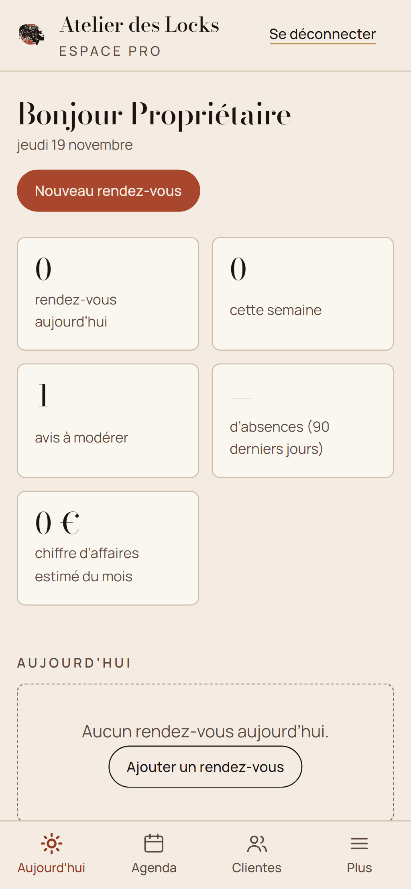 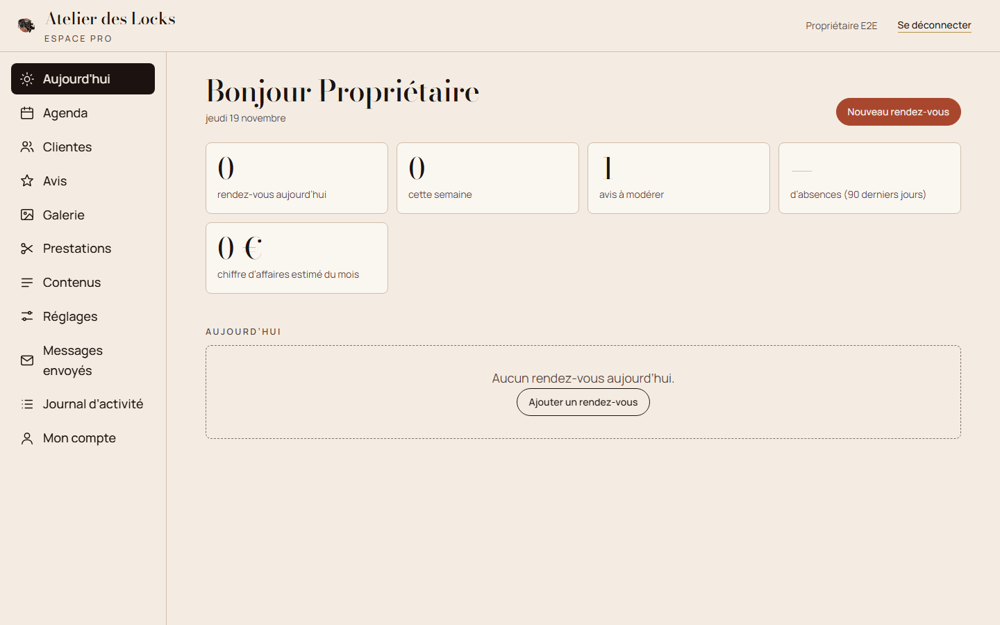

C'est l'écran d'accueil. Il montre :

- les **rendez-vous d'aujourd'hui** et de la semaine ;
- les rendez-vous **« à valider »** (si vous avez choisi de valider chaque demande à la main) ;
- le nombre d'**avis à modérer** ;
- le **taux d'absence** sur les 90 derniers jours ;
- le **chiffre d'affaires estimé du mois** (visible par vous seule : l'équipe ne le voit pas). C'est une estimation faite à partir des prix des prestations réservées.

Le bouton **Nouveau rendez-vous** (en haut) sert à noter une réservation prise par téléphone ou en personne.

**Navigation sur téléphone** : la barre du bas contient _Aujourd'hui_, _Agenda_, _Clientes_ et _Plus_. **Plus** ouvre tout le reste (Avis, Galerie, Prestations, Contenus, Réglages, Messages envoyés, Journal d'activité, Mon compte, Se déconnecter). Sur ordinateur, tout est dans le menu de gauche.

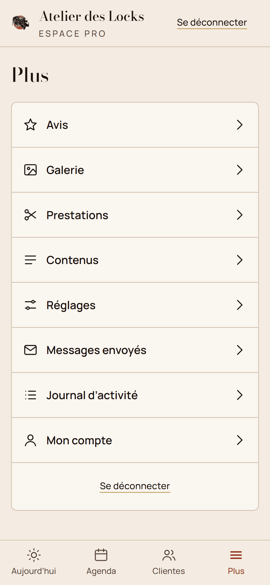

---

## 3. Agenda et rendez-vous

### Voir l'agenda

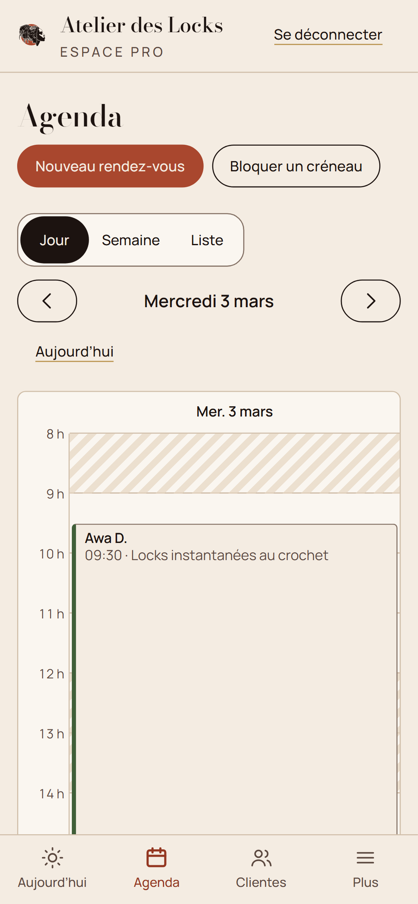 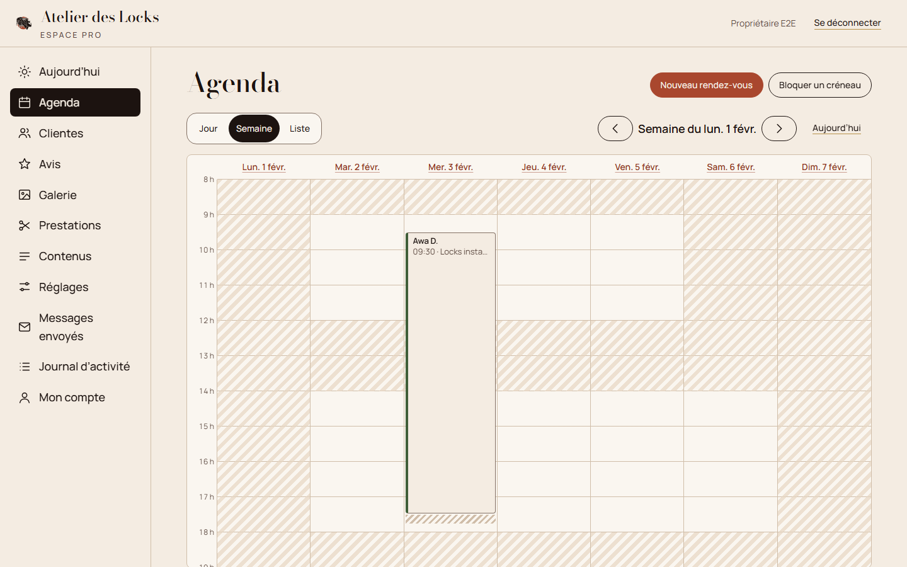

Trois vues, au choix en haut : **Jour**, **Semaine** et **Liste**. Les flèches changent de jour, « Aujourd'hui » revient à aujourd'hui.

- Les zones **hachurées** sont les moments où le salon est **fermé** (horaires, congés).
- Une petite bande après chaque rendez-vous représente le **temps de rangement** (tampon) : aucun autre rendez-vous n'y est proposé.
- Une **ligne « maintenant »** indique l'heure actuelle.

### Ajouter un rendez-vous (réservation par téléphone ou en personne)

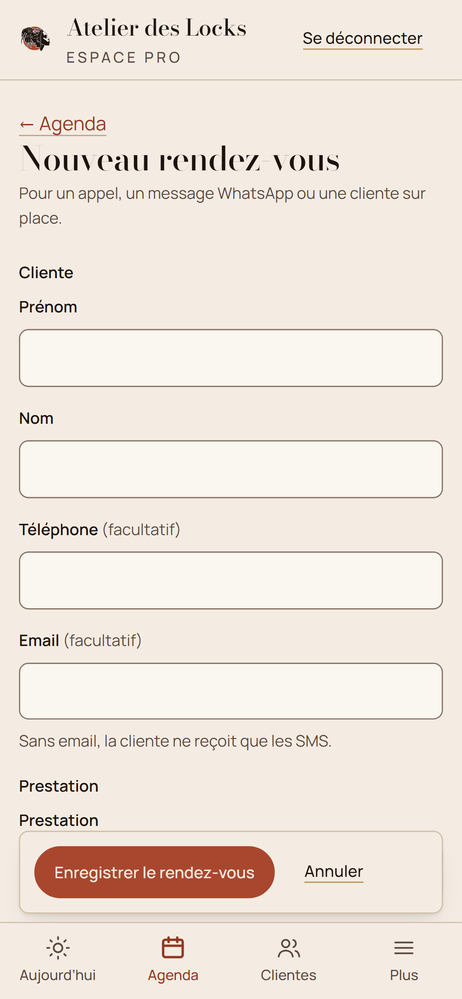

1. Appuyez sur **Nouveau rendez-vous**.
2. Renseignez la cliente (prénom, nom, téléphone, email si elle en a un), la **prestation**, la **date** et l'**heure**.
3. La case **« Envoyer la confirmation et les rappels à la cliente »** est cochée d'office (email avec le lien « Gérer mon RDV », rappel 2 jours avant, SMS la veille) : décochez-la si vous ne voulez pas la prévenir.
4. **Enregistrer le rendez-vous**.

Vous pouvez noter un rendez-vous **en dehors des horaires** habituels (par exemple un samedi exceptionnel) : le site n'impose pas ses règles de réservation en ligne au salon. En revanche, **deux rendez-vous ne peuvent jamais se chevaucher**, et on ne peut pas noter un rendez-vous sur un créneau que vous avez bloqué : le site vous le dit.

Une cliente sans email (réservation par téléphone) est acceptée : elle recevra seulement les SMS.

### Ouvrir un rendez-vous

Touchez un rendez-vous dans l'agenda : sa fiche s'ouvre avec la prestation, ses options, la cliente, le prix estimé, et la **photo de ses cheveux** si elle en a envoyé une (visible uniquement par vous et votre équipe, derrière la connexion).

### Changer l'état d'un rendez-vous

Sur la fiche, la section **Statut** propose :

| Bouton                     | Quand l'utiliser                                                                                                    |
| -------------------------- | ------------------------------------------------------------------------------------------------------------------- |
| **Confirmer**              | Vous acceptez une demande « à valider ». La cliente reçoit un message « rendez-vous validé » (email + SMS).         |
| **Marquer terminé**        | Après la prestation. **Cela déclenche la demande d'avis** envoyée à la cliente quelques heures plus tard.           |
| **Absente**                | La cliente ne s'est pas présentée (compte dans le taux d'absence). Possible seulement après l'heure du rendez-vous. |
| **Remettre à valider**     | Vous revenez en arrière.                                                                                            |
| **Annuler le rendez-vous** | Vous annulez. Le créneau est libéré ; la cliente est prévenue si la case est cochée.                                |

« Terminé » et « Absente » ne sont proposés qu'**une fois le rendez-vous commencé**. Un rendez-vous annulé peut être **rouvert** si son créneau est encore libre.

### Déplacer un rendez-vous

- **Sur ordinateur** : **glissez-déposez** le rendez-vous à un autre moment de l'agenda (par pas de 15 minutes). Une fenêtre vous demande de confirmer et de choisir si la cliente est prévenue. Si le créneau est pris, un message l'explique.
- **Sur téléphone (ou sans glisser)** : ouvrez la fiche, **Choisir un autre créneau**, puis choisissez un créneau libre et **Déplacer le rendez-vous**.

La cliente reçoit un nouveau message avec un **nouveau lien « Gérer mon RDV »** (l'ancien ne fonctionne plus).

### Notes internes

En bas de la fiche : **Notes internes** (allergies, préférences, rappel pour la prochaine fois). Elles ne sont **jamais visibles par la cliente**. Pensez à **Enregistrer les notes**.

### Bloquer un créneau (pause, congé, rendez-vous personnel)

Bouton **Bloquer un créneau** en haut de l'agenda : choisissez la date, les heures et une raison. Plus rien ne peut être réservé en ligne pendant ce temps. Vous pouvez retirer un blocage à tout moment depuis la liste des blocages.

> **Congés plus longs** : pour des vacances, utilisez plutôt **Réglages → Congés et fermetures** (voir §9). Si des rendez-vous existent déjà sur cette période, le site vous avertit. **Il n'annule jamais un rendez-vous tout seul** : c'est à vous de les déplacer ou de prévenir les clientes.

### Votre agenda sur votre téléphone (facultatif)

Si votre administrateur a renseigné `ICAL_FEED_TOKEN`, un **flux d'agenda privé** existe : son adresse (`https://VOTRE-DOMAINE/agenda/<code-secret>.ics`) peut être ajoutée à Google Agenda ou à l'agenda de votre téléphone (« S'abonner à un agenda par adresse »). **Ne partagez jamais cette adresse** : elle contient un code secret.

---

## 4. Clientes

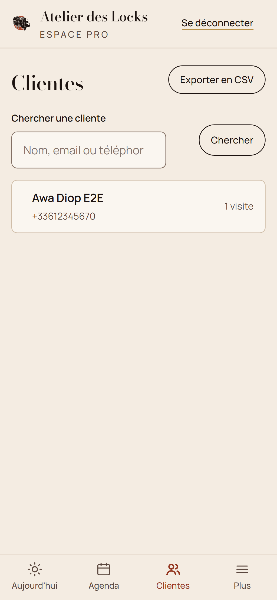 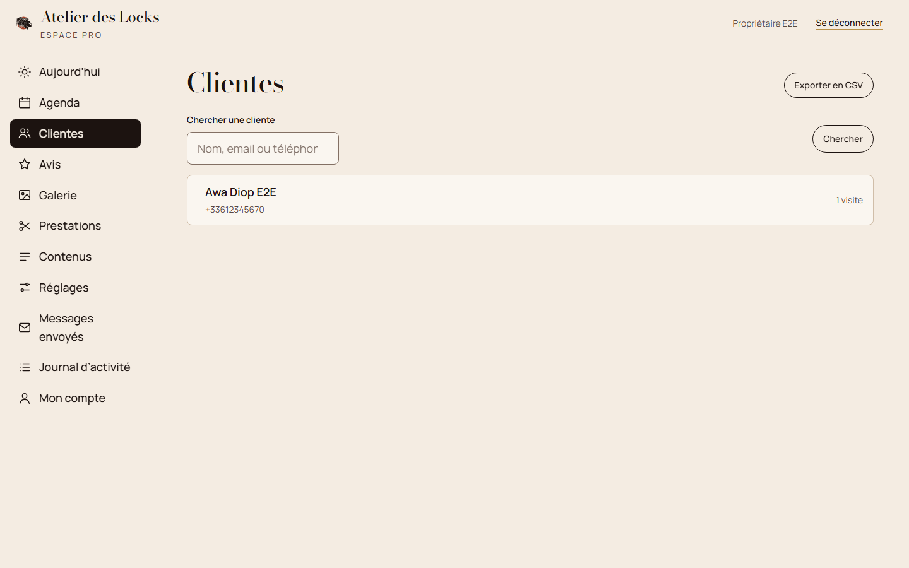

- **Chercher** : tapez un nom, un email ou un téléphone (en format national `06…` ou international).
- **Fiche d'une cliente** : coordonnées, notes, **historique** de ses rendez-vous. Bouton **Nouveau rendez-vous**.
- **Exporter en CSV** : un fichier lisible dans Excel (colonnes séparées par des points-virgules). Cet export contient des données personnelles : **gardez-le sur un appareil protégé et supprimez-le après usage**. Chaque export est inscrit dans le journal d'activité.

### Respecter les droits de vos clientes (RGPD)

Sur la fiche, section **Données personnelles (RGPD)** :

- **Droit d'accès** : si une cliente vous demande « quelles données avez-vous sur moi ? », utilisez le lien **Exporter les données de cette cliente (JSON)** (fichier à lui envoyer).
- **Droit à l'effacement** : **Supprimer cette cliente** remplace son identité (nom, email, téléphone, notes, photos) par une version anonyme. L'historique des rendez-vous reste **sans lien avec une personne** (utile pour votre comptabilité). Ses **rendez-vous à venir sont annulés sans message**. Une confirmation en deux temps est demandée : **c'est définitif**.
- **Conservation automatique** : une cliente **sans aucun rendez-vous depuis 3 ans** est anonymisée toute seule. Les photos de cheveux sont supprimées après **1 an**.

---

## 5. Prestations et tarifs

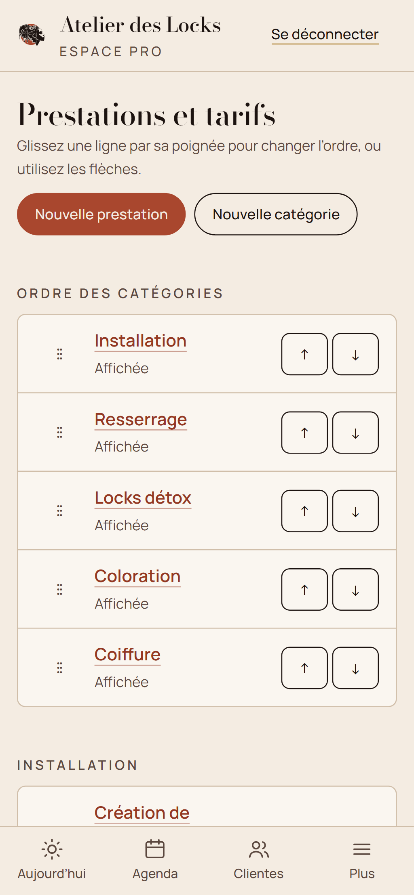 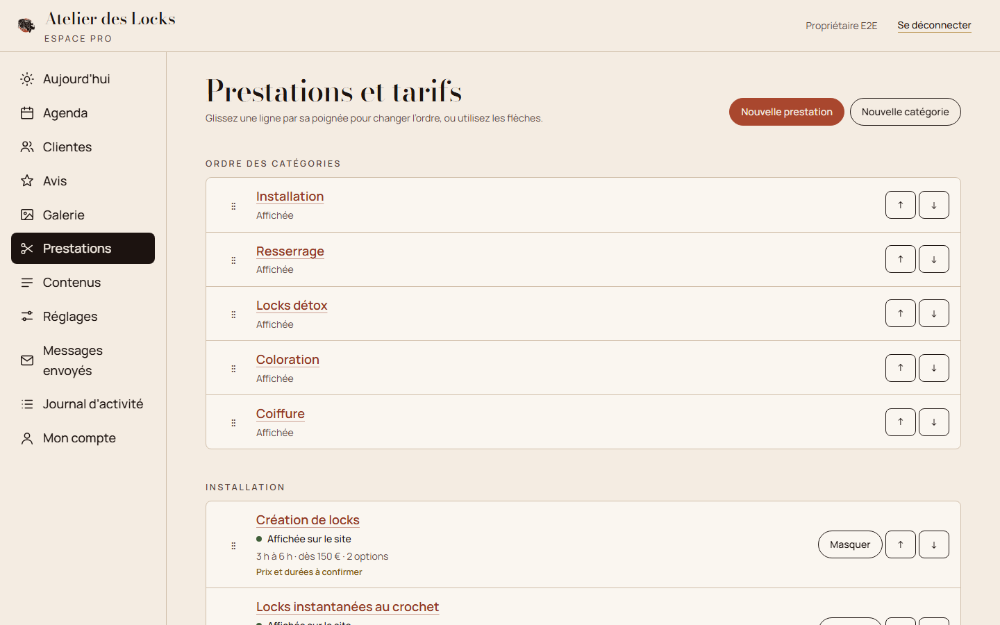

**Réservé à la propriétaire** (l'équipe ne voit pas cet écran).

- **Modifier une prestation** : touchez-la. Vous réglez le **prix**, la **durée** (min. et max.), le **temps de rangement** (tampon), la visibilité (**masquée** = n'apparaît plus sur le site), la mention **« sur devis »** (non réservable en ligne, avec un lien vers le contact), la description.
- **Options** (ex. longueur +) : un prix et un temps en plus.
- **Ordre** : glissez une ligne par sa poignée, ou utilisez les flèches ↑ ↓ (utile sur téléphone). Même chose pour l'ordre des **catégories**.
- **Nouvelle prestation / Nouvelle catégorie / Nouvelle méthode** : boutons en haut.
- **« Prix et durées à confirmer »** : les prestations chargées au départ portent cette mention dans l'admin, car leurs prix et durées sont des **exemples**. Une fois vos vrais prix saisis, cochez la case **« Prix et durées validés par la propriétaire »** en bas du formulaire : la mention disparaît.

⚠️ **Avant l'ouverture au public**, passez **toutes** les prestations en revue : la durée décide des créneaux proposés (la durée **bloquée** = durée maximale + options + rangement). Une durée trop courte laisse la place à un rendez-vous de trop.

**Prestations longues** (4 h ou plus, ex. création de locks) : elles peuvent **traverser la pause de midi** (commencer le matin et finir l'après-midi). Dites-moi si ce n'est pas votre manière de travailler : cela se règle.

---

## 6. Galerie de photos

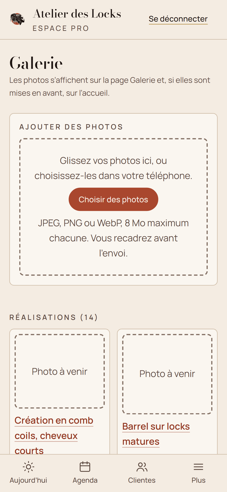 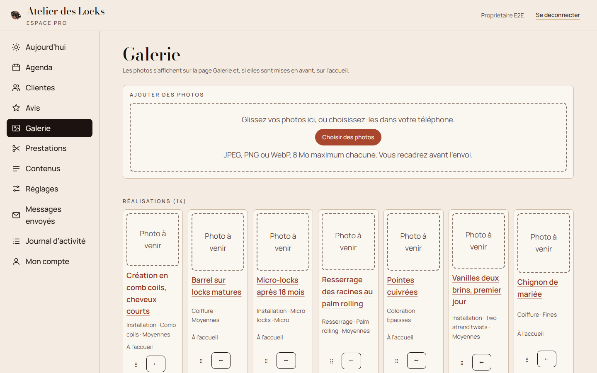

Vos réalisations s'affichent sur la page **Galerie** et, si vous les **mettez en avant**, sur l'accueil.

1. **Choisir des photos** (plusieurs à la fois), ou glissez-les depuis votre ordinateur.
2. Pour chacune : **recadrez** (Portrait, Carré, Paysage, zoom), puis ajoutez les **étiquettes** (prestation, méthode, taille).
3. Écrivez le **texte alternatif** : une phrase qui décrit la photo (« Locks sisterlocks tombant sur les épaules, coiffure d'une cliente de dos »). **Il est obligatoire** : il permet aux personnes malvoyantes de comprendre la photo et aide au référencement. Une suggestion est proposée.
4. **Envoyer cette photo**.

Vous pouvez ensuite changer l'**ordre**, **mettre en avant**, modifier ou retirer une photo. Chaque photo est automatiquement **allégée et nettoyée** : les données cachées (lieu, appareil) sont retirées.

> **Droit à l'image** : n'ajoutez que des photos de personnes qui ont donné **leur accord** (idéalement par écrit).
> Les photos de départ du site sont des **visuels d'exemple** : remplacez-les par les vôtres.

---

## 7. Avis

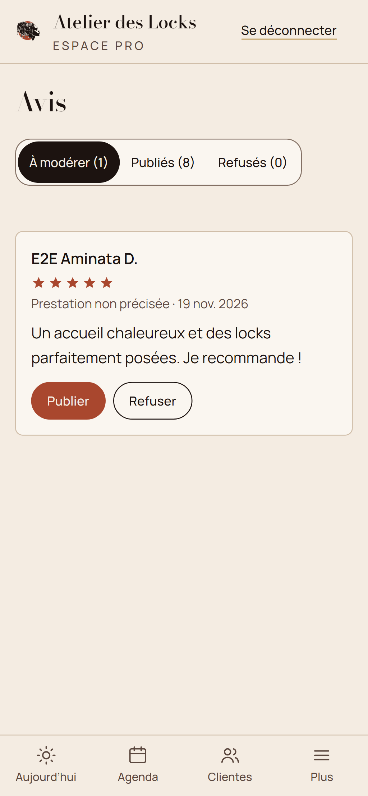 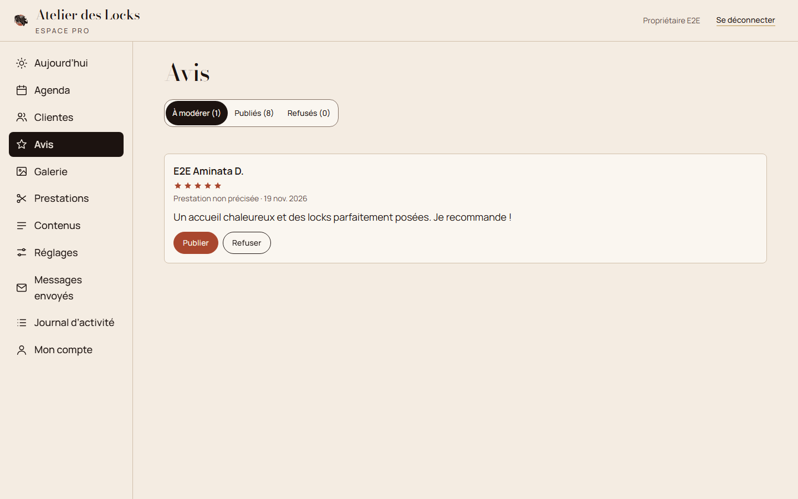

Après chaque rendez-vous **marqué terminé**, la cliente reçoit un lien pour laisser un avis (note de 1 à 5, texte, prénom, photo facultative). Les avis arrivent **« à modérer »** : **rien n'est publié sans vous**.

Pour chaque avis :

- **Publier** : il apparaît sur le site (page Avis, page de la prestation concernée, accueil). Un avis n'est **jamais publié sans le consentement** coché par la cliente.
- **Refuser** : il n'apparaît pas.
- **Mettre à l'accueil** (ou **Retirer de l'accueil**) : un avis publié peut être affiché sur la page d'accueil.
- **Répondre publiquement** (ou **Modifier ma réponse**) : possible sur un avis publié ; saisissez votre réponse, puis **Enregistrer la réponse**.

Les avis déposés via le lien reçoivent la mention **« vérifié »** (cliente réelle, rendez-vous réel).

> Tant qu'il n'y a **aucun avis publié**, le site masque la section (accueil) ou affiche « Les premiers avis arrivent bientôt ».
> Vous pouvez aussi encourager vos clientes à laisser un avis **Google** : le lien est proposé sur la page Avis et au remerciement (réglé par votre administrateur).

---

## 8. Contenus du site

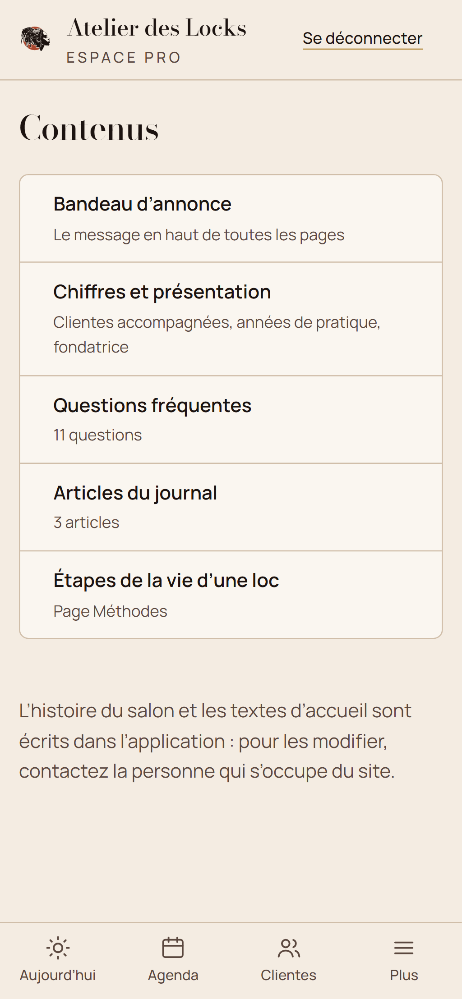

**Réservé à la propriétaire.** Vous y modifiez les textes qui bougent :

- le **bandeau d'annonce** (le message en haut de toutes les pages : « Fermé du 3 au 17 août »…), que vous pouvez désactiver ;
- les **chiffres et la présentation** (nombre de clientes accompagnées, années d'expérience, fondatrice) ;
- la **FAQ** (questions fréquentes) ;
- les **articles** du journal (conseils d'entretien) ;
- les **étapes de la vie d'une loc**.

Les textes de **l'accueil** et de **« Le salon »** sont encore dans le code du site : demandez-moi les modifications (voir §14).

---

## 9. Réglages

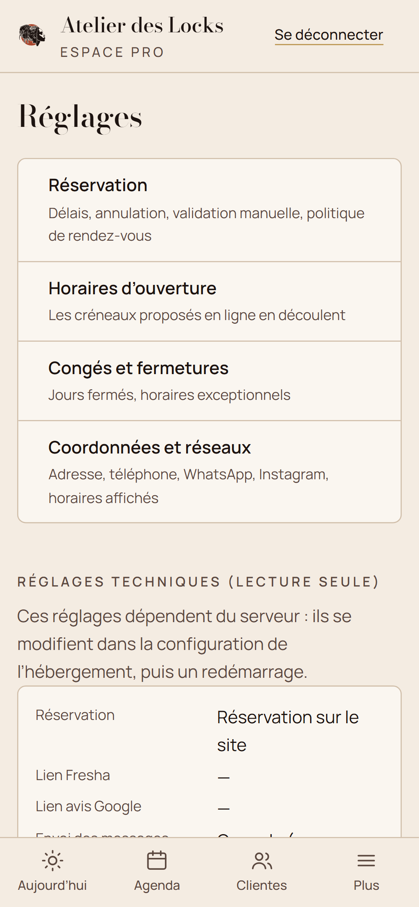 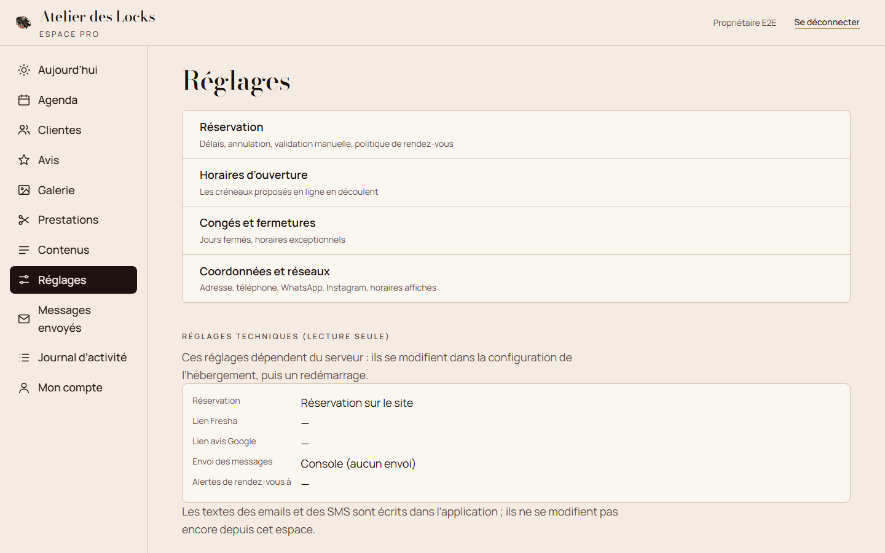

**Réservé à la propriétaire.** Quatre rubriques :

### Réservation

- **Délai minimum** avant un rendez-vous (24 h par défaut) : une cliente ne peut pas réserver pour dans 2 heures.
- **Horizon** : jusqu'à combien de jours à l'avance on peut réserver (60 jours par défaut).
- **Délai d'annulation** : jusqu'à combien d'heures avant, la cliente peut déplacer ou annuler **seule** (48 h par défaut). Passé ce délai, elle doit vous appeler.
- **Validation manuelle** : si activée, chaque demande arrive « à valider » et la cliente n'est confirmée qu'après votre accord.
- **Texte de la politique de rendez-vous** : affiché avant la réservation et sur la page « Gérer mon RDV ».

### Horaires d'ouverture

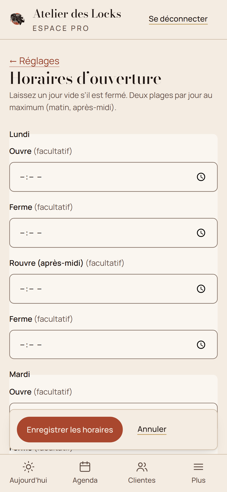

Laissez un jour **vide** s'il est fermé. **Deux plages par jour** au maximum (matin, après-midi). Un enregistrement entièrement vide est refusé (il fermerait tout le salon).

### Congés et fermetures

Ajoutez une période de fermeture (vacances, jour férié) ou des **horaires spéciaux** un jour donné. Si des rendez-vous existent déjà, un avertissement s'affiche ; **rien n'est annulé automatiquement**.

### Coordonnées et réseaux

Téléphone, WhatsApp, Instagram, adresse : ils s'appliquent **sur tout le site** (en-tête, pied de page, page Contact).

Une section **Réglages techniques** (en lecture seule) affiche des informations utiles pour le support ; elle ne se modifie pas ici.

---

## 10. Messages envoyés et journal d'activité

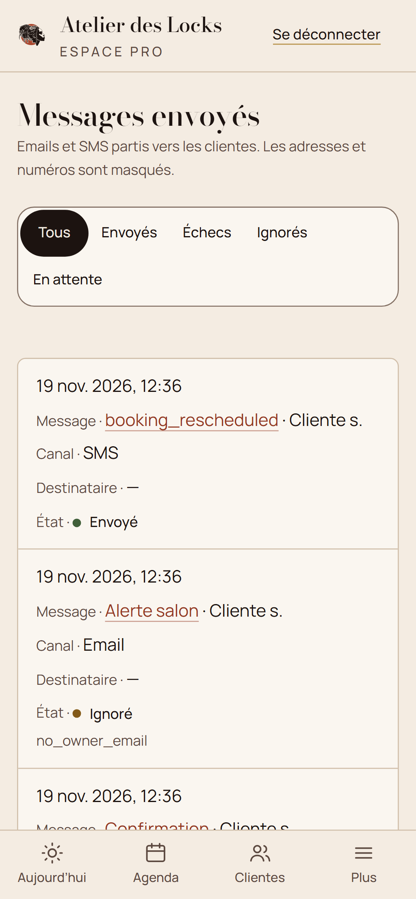 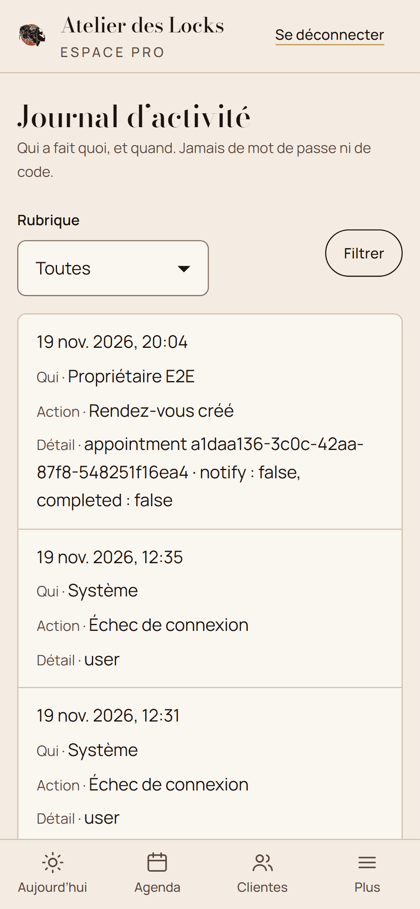

**Réservé à la propriétaire.**

- **Messages envoyés** : tous les emails et SMS partis vers vos clientes (confirmation, rappel, avis…), avec leur **état** : **Envoyé**, **En attente**, **Ignoré** (le message n'avait plus lieu d'être, par exemple rendez-vous annulé entre-temps) ou **Échec**. Utile pour répondre à « je n'ai rien reçu ». Les adresses et numéros sont **partiellement masqués**. Un filtre par état est disponible.
- **Journal d'activité** : qui a fait quoi dans l'espace pro (connexion, modification d'un prix, export, suppression…), avec la date. Il ne peut pas être modifié. Utile si vous avez une équipe, ou en cas de doute.

---

## 11. Mon compte

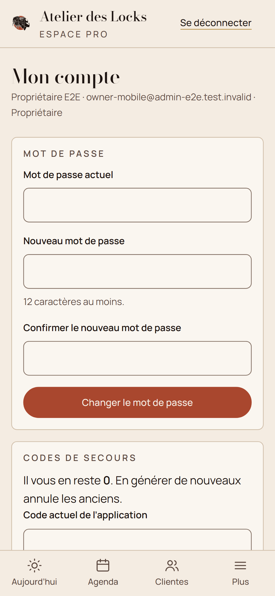

- **Changer votre mot de passe** (12 caractères au minimum ; une phrase longue est idéale). Changer de mot de passe **déconnecte vos autres appareils**.
- **Générer de nouveaux codes** de secours si vous n'en avez plus (les anciens cessent de fonctionner).

Pour **ajouter une employée** (compte « équipe »), ou **réinitialiser une double authentification perdue**, voir §13 et §14.

**Droits de l'équipe** : une employée voit le **tableau de bord (sans le chiffre d'affaires)**, l'**agenda**, les **clientes** (lecture et notes), la **galerie** et les **avis**. Elle **ne voit pas** les prestations et tarifs, les contenus, les réglages, les messages envoyés, le journal, l'export des clientes ni la suppression d'une cliente.

---

## 12. Ce que vos clientes reçoivent automatiquement

Vous n'avez rien à faire : le site s'en charge.

| Quand                                                               | Quoi                                                                                                                  | Par         |
| ------------------------------------------------------------------- | --------------------------------------------------------------------------------------------------------------------- | ----------- |
| Elle réserve                                                        | **Confirmation** avec le récapitulatif, les conseils de préparation, le fichier d'agenda et le lien « Gérer mon RDV » | Email + SMS |
| Vous recevez une réservation (ou un déplacement, ou une annulation) | **Alerte** sur votre adresse email                                                                                    | Email       |
| 2 jours avant, à 10 h                                               | **Rappel**                                                                                                            | Email       |
| La veille, à 18 h                                                   | **Rappel**                                                                                                            | SMS         |
| Elle déplace ou annule                                              | Message de confirmation                                                                                               | Email + SMS |
| Vous validez une demande « à valider »                              | « Rendez-vous validé »                                                                                                | Email + SMS |
| 3 heures après un rendez-vous « terminé »                           | **Demande d'avis**                                                                                                    | Email       |
| 5 jours plus tard, si pas d'avis                                    | **Une seule relance**                                                                                                 | Email       |

- Si un rendez-vous est annulé ou déplacé, les rappels déjà programmés **sont écartés** : une cliente ne reçoit jamais un rappel pour un rendez-vous qui n'existe plus.
- Un message n'est **jamais envoyé deux fois**.
- Un rendez-vous « à valider » ne reçoit pas de rappel avant d'être confirmé.
- La cliente peut **déplacer ou annuler elle-même** (jusqu'au délai d'annulation) depuis le lien « Gérer mon RDV », sans compte ni mot de passe.

Pour modifier le **texte** de ces messages, voir §14.

---

## 13. Questions fréquentes

**J'ai perdu mon téléphone.** Connectez-vous avec un **code de secours** (chacun sert une fois). Une fois dedans, **Mon compte → Générer de nouveaux codes**, et reconfigurez l'application sur le nouveau téléphone. Si vous n'avez plus aucun code : contactez la personne qui administre le serveur, qui peut réinitialiser votre double authentification (commande `admin-recover --reset-2fa`, voir `docs/DEPLOIEMENT.md`).

**Mon code à 6 chiffres est refusé.** Vérifiez **l'heure de votre téléphone** : elle doit être réglée sur « automatique ». Attendez le code suivant (30 s) et réessayez. Un même code ne peut pas servir deux fois.

**Mon compte est verrouillé.** Trop d'essais : attendez la fin du délai (jusqu'à 1 h si les échecs se répètent).

**Je veux ajouter une employée.** Pour l'instant, c'est l'administrateur du serveur qui crée le compte (commande `node scripts/create-admin.js --role staff`). Chaque personne a **son propre** compte et configure **son propre** téléphone.

**Une cliente dit ne pas avoir reçu d'email.** Ouvrez **Messages envoyés** et cherchez-la : **Envoyé** = parti chez Brevo : demandez-lui de vérifier ses **courriers indésirables** ; **Échec** = adresse invalide ou problème d'envoi (la raison s'affiche sous l'état).

**Un créneau n'apparaît pas à la réservation.** Raisons habituelles : un rendez-vous ou un blocage s'y trouve ; le délai minimum (24 h) ; hors horizon ; hors horaires d'ouverture ; la durée bloquée de la prestation (avec rangement) ne tient pas avant la fermeture ; congé ou fermeture.

**Une cliente veut changer de prestation.** Annulez le rendez-vous et créez-en un nouveau (le créneau se libère immédiatement).

**Je me suis trompée de rendez-vous annulé.** **Remettre à valider** / rouvrir le rendez-vous, si le créneau est encore libre.

**Je veux fermer le site aux réservations quelques jours.** **Réglages → Congés et fermetures**, ou **Bloquer un créneau**.

**Est-ce que je risque de perdre mes données ?** Elles sont sauvegardées **chaque nuit**, chiffrées, et copiées hors du serveur (voir `docs/DEPLOIEMENT.md`, étape 12). Une répétition de restauration est à faire chaque mois.

**À qui demander de l'aide ?** Notez la date, l'heure et ce que vous faisiez (ou une capture d'écran sans données de clientes). Le journal d'activité aide à retrouver ce qui s'est passé.

---

## 14. Ce qui ne se modifie pas encore ici

Pour ces points, il faut passer par la personne qui développe le site (l'évolution est prévue) :

- le **texte exact des emails et des SMS** (le contenu est pensé pour rester court et fonctionner partout : 160 caractères maximum pour les SMS) ;
- les **textes de l'accueil** et de la page **« Le salon »** (histoire, portrait) ;
- les **pages légales** (mentions légales, confidentialité, CGV) ;
- les **horaires différents selon la praticienne** (aujourd'hui, la même grille pour toutes) ;
- la **gestion des comptes** de l'équipe (création, désactivation, double authentification perdue) ;
- les réglages d'**infrastructure** (mode de réservation, lien Fresha, lien d'avis Google, fournisseur d'envoi).

---

_Dernière mise à jour : phase 8 (mise en production)._
